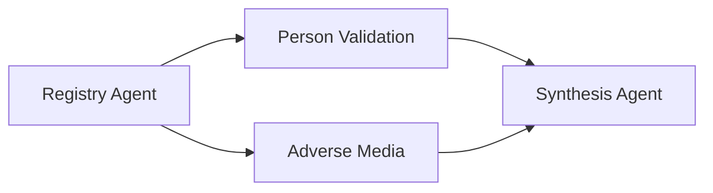

# AI Agent Architecture

The AI agent layer is one of the strongest parts of the system. The `app/agents/` package contains 33 modules: the agents and engines listed below plus their supporting helpers (the OSINT orchestrator is split across `osint_agent.py`, `osint_phases.py`, `osint_network_phase.py`, `osint_post_processing.py`, `osint_belief_updates.py`, `osint_cache_reuse.py`, `osint_context_builders.py`, `osint_evoi_init.py`, `osint_reasoning_eval.py`, and `osint_reasoning_filters.py`). All agents follow a consistent pattern built on PydanticAI, producing structured Pydantic model outputs that integrate cleanly with the rest of the codebase.

## Agent Inventory

| # | Agent | File | Purpose | Model | Tools |
|---|-------|------|---------|-------|-------|
| 1 | Registry Agent | `registry_agent.py` | Corporate registry lookup via NorthData | GPT-5.2 | NorthData MCP (Stdio) |
| 2 | Belgian Agent | `belgian_agent.py` | Belgian 4-source investigation | GPT-5.2 | None (tools via services) |
| 3 | Belgian Scraping Agent | `belgian_scraping_agent.py` | Gazette web scraping | GPT-4.1-mini | crawl4ai |
| 4 | Person Validation Agent | `person_validation_agent.py` | LinkedIn profile validation | GPT-5.2 | BrightData MCP (SSE) |
| 5 | Adverse Media Agent | `adverse_media_agent.py` | Sanctions, fraud, PEP screening | GPT-5.2 | Tavily REST (httpx, no MCP) |
| 6 | Synthesis Agent | `synthesis_agent.py` | Risk assessment synthesis | GPT-5.2 | None (reasoning only) |
| 7 | Document Validator | `document_validator.py` | Document-to-requirement validation | GPT-5.2 | None |
| 8 | MCC Classifier | `mcc_classifier.py` | Merchant Category Code assignment | GPT-5.2 | NACE-to-MCC lookup (local) |
| 9 | Task Generator | `task_generator.py` | Follow-up task suggestion | GPT-5.2 | None |
| 10 | Dashboard Agent | `dashboard_agent.py` | CopilotKit AI assistant | GPT-5.2 | Case search, data retrieval, **write tools** (see below) |
| 11 | Dashboard Stats Agent | `dashboard_stats_agent.py` | Analytics question answering | GPT-5.2 | None |
| 12 | OSINT Orchestrator | `osint_agent.py` | Pipeline coordination | N/A | Coordinates agents 1-6 |
| 13 | Website Scraper | (in activities.py) | Company website content extraction | N/A | crawl4ai |
| 14 | Confidence Engine | `services/confidence_engine.py` | 4-dimension confidence scoring (evidence completeness, source diversity, consistency, historical calibration) | N/A | Deterministic computation |
| 15 | Red Flag Engine | `services/red_flag_engine.py` | Deterministic rule evaluation against findings, discrepancies, and metadata | N/A | Rule engine |
| 16 | EVOI Engine | `services/evoi_engine.py` | Adaptive investigation depth via Expected Value of Investigation | N/A | Deterministic computation |
| 17 | Governance Engine | `services/governance_engine.py` | 3-mechanism deterministic safety enforcement (pre-execution, post-execution, memory write) | N/A | Deterministic rules |
| 18 | Memory Admin Agent | `memory_admin_agent.py` | Compliance memory administration | GPT-5.2 | Letta tools |
| 19 | Scan Agent | `scan_agent.py` | Tiered entity scanning orchestrator (Tier 0-3: E-VAL, lightweight, standard, full) | N/A | Coordinates tier services |
| 20 | Scan Synthesis Agent | `scan_synthesis_agent.py` | Risk narrative generation for Tier 2 scan results | GPT-5.2 | None |
| 21 | Sanctions Resolver Agent | `sanctions_resolver_agent.py` | LLM-based disambiguation of fuzzy sanctions matches (0.80-0.95 similarity) | GPT-5.2 | None |
| 22 | Case Intelligence Agent | `case_intelligence_agent.py` | Decision support via historical case comparison and pattern analysis (EU AI Act Art. 14 compliant) | GPT-5.2 | None |
| 23 | Finding Debugger | `finding_debugger.py` | Root cause analysis when officer rejects a finding (prompt gap, hallucination, missing data) | GPT-5.2 | Investigation trace retrieval |
| 24 | Document Extractor | `document_extractor.py` | Structured data extraction from Docling-converted documents (UBO ownership, director details) | GPT-4.1-mini | None |
| 25 | Country Registry | `country_registry.py` | Country-specific registry provider abstraction routing to BE, CZ, EE, CH, FR, NL, NO, DK, FI agents | N/A | Provider dispatch |
| 26 | Social Intelligence Agent | `social_intelligence_agent.py` | Social/web-presence intelligence (LinkedIn, Google Maps, Yahoo Finance, etc.) | GPT-5.2 | BrightData MCP (StreamableHTTP) |
| 27 | Financial Analysis Agent | `financial_analysis_agent.py` | Ratio analysis + Altman/Ohlson/Zmijewski distress models + peer benchmarks (ADR-0048) | N/A | Deterministic computation |

## Dashboard Agent Write Tools

As of 2026-03-31, the `dashboard_agent` exposes three **write tools** that let officers take case actions through natural-language chat. These are registered on the CopilotKit `CopilotRuntime` server alongside the existing read tools.

| Tool | Backend | Description |
|------|---------|-------------|
| `resolve_discrepancy` | `POST /api/cases/{id}/discrepancies/{discrepancy_id}/resolve` | Mark a data discrepancy as resolved with an explanation. Resolution is persisted to the `discrepancy_resolutions` table and appended to the case audit log. |
| `add_case_note` | `POST /api/cases/{id}/notes` | Add a free-text compliance note to a case. Notes are stored with officer identity and timestamp. |
| `submit_finding_feedback` | `POST /api/cases/{id}/findings/{finding_id}/feedback` | Submit officer feedback (accept / reject / flag) on an individual finding. Feeds into the Quality Scorer calibration loop. |

The dashboard prompt template (`prompts/templates/dashboard.jinja2`) was updated with a **Case Actions** section describing when and how to invoke these tools. Each tool call is individually audited via the `tool_audit_service` (EU AI Act Art. 12 compliance — automatic logging of all AI operations).

## PydanticAI Agent Pattern

Every agent follows the same structure:

```python
from pydantic_ai import Agent
from app.config import get_agent_model

# 1. Define structured output model
class AgentOutput(BaseModel):
    risk_score: float
    findings: list[Finding]
    summary: str

# 2. Build prompt with case context
def build_prompt(company_name: str, ...) -> str:
    return f"""You are a specialist investigator...
    COMPANY: {company_name}
    ..."""

# 3. Create agent with model, output type, and optional tools
async def run_agent(company_name: str, ...) -> AgentOutput:
    agent = Agent(
        get_agent_model("agent_name_model"),
        output_type=AgentOutput,
        instructions=build_prompt(company_name, ...),
        toolsets=[mcp_server],  # optional
    )
    async with agent:
        result = await agent.run(
            f"Investigate {company_name}...",
            usage_limits=UsageLimits(request_limit=150),
        )
    return result.output
```

### Key Design Decisions

- **Structured outputs** -- Every agent returns a typed Pydantic model, not free-form text. This makes downstream processing reliable.
- **Per-agent model configuration** -- Each agent reads its model string from `config.py`, allowing different models for different tasks (e.g., GPT-4.1-mini for scraping, GPT-5.2 for synthesis).
- **Graceful degradation** -- Every agent runner wraps execution in try/except and returns a safe fallback output on failure, with an error finding included.
- **Usage limits** -- Agents have explicit `request_limit` caps to prevent runaway token consumption.

## MCP Tool Integration

Two MCP (Model Context Protocol) transports are used. Tavily is **no longer** accessed via MCP — adverse-media searches run as deterministic REST calls (`https://api.tavily.com/search`) through `httpx`; `get_tavily_server()` is a legacy stub.

| Transport | Provider | Used By | Connection |
|-----------|----------|---------|------------|
| `MCPServerStdio` | NorthData | Registry Agent | Local subprocess |
| `MCPServerStreamableHTTP` | BrightData | Person Validation, Social Intelligence, Crunchbase enrichment | Remote streaming-HTTP endpoint |

```python
# Stdio (local process)
mcp_server = MCPServerStdio(
    sys.executable,
    args=[server_path],
    env={"NORTHDATA_API_KEY": settings.northdata_api_key},
)

# Streamable HTTP (remote) — BrightData
mcp_server = MCPServerStreamableHTTP(
    url=f"https://mcp.brightdata.com/mcp?token={settings.brightdata_api_token}"
)

# Tavily adverse media — REST, not MCP
results = await httpx_client.post("https://api.tavily.com/search", json={...})
```

### MCP hard timeouts (2026-04-13)

BrightData-backed calls wrap `agent.run()` inside `async with agent:`
with `asyncio.wait_for(..., timeout=N)` so cancellation cleanly tears
down the MCP client instead of leaking a CLOSE_WAIT socket. This
eliminates the worker-zombie pattern observed during multi-country
validation. Timeouts: social intelligence 180s, person validation 300s,
Crunchbase enrichment 90s. On timeout the agent emits a LOW-severity
`*_timeout` finding and the pipeline continues. Commit `1baa085c`.

## Mock Mode System

Every agent has a corresponding mock mode flag in the configuration. All mock-mode flags default to `False` (real calls); they are opt-in. The `get_agent_model()` helper also falls back to `"test"` automatically when no LLM API key is configured. When a flag is enabled, agents use PydanticAI's `TestModel` which returns deterministic outputs matching the output schema without making real LLM calls.

```python
def get_agent_model(model_field: str, mock_flag: str | None = None) -> str:
    if mock_flag and get_mock_flag(mock_flag):
        return "test"           # PydanticAI TestModel
    if not settings.llm_api_key:
        return "test"           # No API key = test mode
    return getattr(settings, model_field)  # Real model string
```

| Mock Flag | Controls |
|-----------|----------|
| `osint_mock_mode` | Registry, Person Validation, Adverse Media, Synthesis |
| `task_generator_mock_mode` | Task Generator |
| `mcc_mock_mode` | MCC Classifier |
| `doc_validation_mock_mode` | Document Validator |
| `belgian_mock_mode` | Belgian Agent + scraping |
| `brightdata_mock_mode` | BrightData MCP tools (Person Validation, Social Intelligence) |
| `social_intelligence_mock_mode` | Social Intelligence Agent |
| `tavily_mock_mode` | Tavily REST search (adverse media) |
| `doc_extraction_mock_mode` | Document Extractor |
| `gleif_mock_mode` | GLEIF/LEI check |
| `case_intelligence_mock_mode` | Case Intelligence Agent |
| `quality_scoring_mock_mode` | Quality Scorer |
| `finding_debugger_mock_mode` | Finding Debugger |

Mock modes can be toggled at runtime via `PATCH /api/test/mock-modes` (PoC mode only), with overrides persisted to a shared file that both the backend and worker processes read.

## Country Routing

The OSINT orchestrator dispatches to different registry agents based on the case's country:

```python
async def _dispatch_registry_agent(country: str, ...) -> RegistryAgentOutput:
    if country.upper() == "BE":
        return await run_belgian_agent(...)
    return await run_registry_agent(...)  # NorthData (DACH, NL, etc.)
```

The Belgian agent queries four official data sources (KBO, Gazette, NBB, Inhoudingsplicht) and produces the same `RegistryAgentOutput` schema as the NorthData agent, making the downstream pipeline country-agnostic.

## OSINT Pipeline Coordination

The OSINT orchestrator (`osint_agent.py`) coordinates the four investigation agents in a DAG pattern:



1. **Registry Agent** runs first (must complete to provide director/UBO names)
2. **Person Validation**, **Adverse Media**, **Social Intelligence**, and **Financial Analysis** run in parallel via `asyncio.gather`
3. **Synthesis Agent** runs last, combining the parallel agent outputs

(The mermaid above is simplified to the two original screening branches; `social_intelligence` and `financial_analysis` join the same parallel fan-out at column 6 — see [Agentic OS Foundation](/docs/architecture/agentic-os) for the full topology.)

Each agent reports its status (pending, running, success, failed, reused) to the `agent_executions` table for real-time pipeline visualization in the dashboard.

See [OSINT Pipeline](/docs/architecture/osint-pipeline) for complete details including the Belgian investigation flow and evidence chain.

## Agent Testing

All agents are tested with PydanticAI's `TestModel`:

```python
# Environment variable prevents accidental real API calls
os.environ["ALLOW_MODEL_REQUESTS"] = "False"

# TestModel returns deterministic outputs matching the Pydantic schema
agent = Agent("test", output_type=RegistryAgentOutput, ...)
```

External API dependencies (BrightData, Tavily, NorthData) are mocked at the HTTP boundary using `respx`, never at the agent level. This ensures the agent's prompt engineering and output parsing logic is exercised in tests.

## CompanyProfile Enrichment

After the registry agent completes, its results are used to enrich the `CompanyProfile` model:

```python
# Extract facts from registry agent output
facts = {}
if registry_output.company_status:
    facts["company_status"] = registry_output.company_status
if registry_output.directors:
    facts["directors"] = ", ".join(registry_output.directors)
if registry_output.financial_health_report:
    evidence_hash = hash_response(registry_output.financial_health_report)
    profile_svc.add_evidence_ref(company_profile, source=source_label, ...)

profile_svc.save(company_profile)
```

The CompanyProfile is a cross-source fact aggregation model stored in MinIO. It detects discrepancies when facts from different sources conflict (e.g., different addresses from KBO vs VIES).
