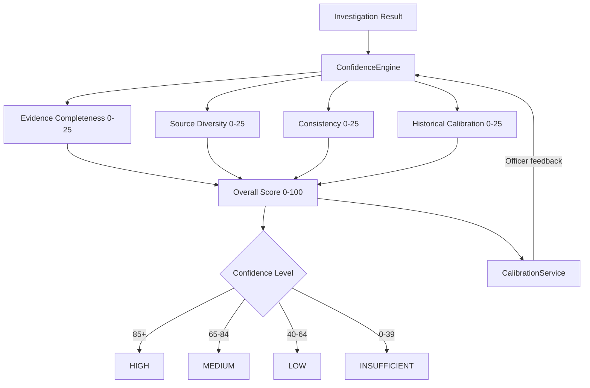

# Investigation Confidence Scoring (Pillar 1)

Quantified certainty for every compliance investigation — replacing binary pass/fail with a 4-dimension confidence framework.

## Business Value

Compliance officers need to understand not just *what* the AI found, but *how certain* it is. Confidence Scoring provides a 0-100 score decomposed into four independently measurable dimensions, enabling evidence-based decision-making.

## Architecture



## Confidence Dimensions

| Dimension | Range | Measures |
|-----------|-------|----------|
| Evidence Completeness | 0-25 | Coverage of required document categories |
| Source Diversity | 0-25 | Number and variety of independent sources |
| Consistency | 0-25 | Agreement between sources on key facts |
| Historical Calibration | 0-25 | Accuracy of similar past predictions |

## Confidence Levels

| Level | Score Range | Action |
|-------|-----------|--------|
| HIGH | 85-100 | Automated approval eligible |
| MEDIUM | 65-84 | Standard review |
| LOW | 40-64 | Enhanced review recommended |
| INSUFFICIENT | 0-39 | Additional investigation required |

## Workflow Integration

Confidence scoring is invoked through the `_compute_and_store_confidence()` helper method, which was extracted from the workflow's `run` method during the codebase hardening sweep (change I6). This helper is shared between the KYC and KYB investigation paths — both call it after their respective investigation activities complete.

```python
# Shared for both KYC and KYB paths
await self._compute_and_store_confidence(
    input, investigation_result, retry_policy
)
```

The helper:
1. Checks the `confidence-score-v1` version gate (skipped for old workflow histories)
2. Calls the `compute_confidence_score` activity with a 30-second timeout
3. Appends the result to `self._state.confidence_scores`
4. Logs a `confidence_computed` audit event
5. Swallows all exceptions (confidence scoring is best-effort — a scoring failure never blocks case progression)

Prior to I6, confidence scoring was duplicated inline in both the KYC and KYB branches. Extracting it to `_compute_and_store_confidence()` eliminates the duplication and ensures both paths always score using identical logic.

## Key Components

- **`confidence_engine.py`** — Core scoring engine with dimensional computation. The `ConfidenceScore`/`ConfidenceLevel` Pydantic models live in the shared `trustrelay_models.confidence` package (ADR-0037); `level_from_score()` applies the 85/65/40 thresholds.
- **`calibration_service.py`** — Feedback loop: officer decisions are recorded via `record_data_point()` and surfaced via `get_calibration_stats()`, feeding the Historical Calibration dimension.
- **`quality_scorer.py`** — LLM-as-judge quality scoring used alongside the deterministic confidence engine.
- **`ConfidenceScoreCard.tsx`** — Visual breakdown in case detail view

## API Endpoint

The confidence router is mounted under `/api/cases` (`app/api/confidence.py`):

| Method | Path | Description |
|--------|------|-------------|
| GET | `/api/cases/{workflow_id}/confidence` | Get the latest 4-dimension confidence breakdown for a case |

Calibration is not exposed as a standalone REST surface: officer decisions feed
`CalibrationService.record_data_point()` internally from the decision flow, and
`get_calibration_stats()` supplies the Historical Calibration dimension at scoring time.

## Configuration

- The confidence score is computed by the `compute_confidence_score` Temporal activity and is best-effort: a scoring failure never blocks case progression. There is no dedicated `confidence_scoring_enabled` feature flag — scoring runs as part of the workflow, gated by the `confidence-score-v1` workflow version guard.
- Alembic migration: `006_calibration_data`
