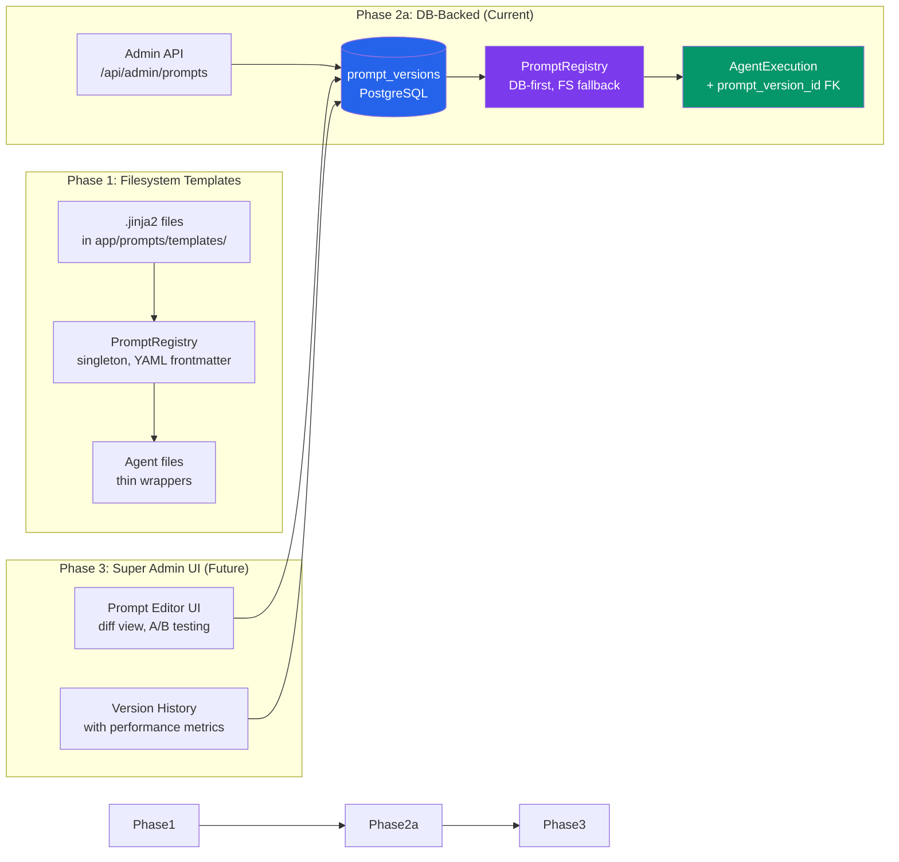
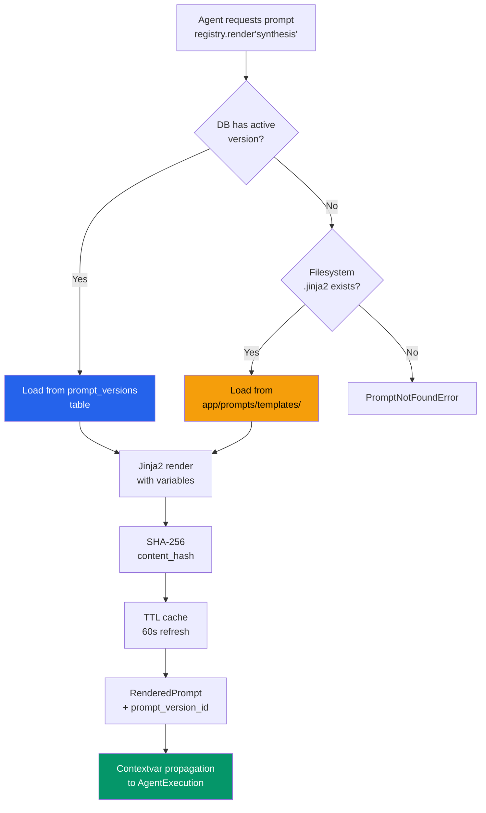
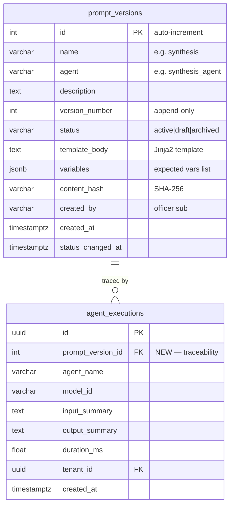
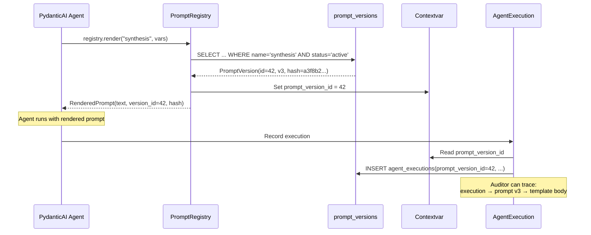

# Prompt Management

Atlas ships **31 named AI agent prompt templates** (plus 5 reusable `_`-prefixed partials) in `app/prompts/templates/`, spanning ~25 distinct agents. The Prompt Management system centralizes these prompts with **version control**, **DB-backed storage**, and **EU AI Act traceability** — every AI output is linked to the exact prompt version that produced it.

## Architecture Evolution



## Prompt Registry

The `PromptRegistry` singleton (`app/prompts/registry.py`) manages all named prompts with a layered loading strategy. Filesystem `.jinja2` templates form the baseline; active rows from the `prompt_versions` table are overlaid on top (DB-first, FS fallback) and refreshed on a 60-second TTL:



## Prompt Inventory (31 named templates)

Each template's `name` and `agent` are declared in its YAML frontmatter. The `name` is the key passed to `registry.render(name, ...)`. Files prefixed with `_` are partials included via `` and are not directly renderable.

| Prompt Name | Agent | Domain |
|---|---|---|
| `synthesis` | synthesis_agent | Investigation synthesis |
| `task_generator` | task_generator | Follow-up task creation |
| `registry_investigation` | registry_agent | Company registry OSINT |
| `belgian_investigation` | belgian_agent | Belgian data collection |
| `belgian_gazette` | belgian_scraping_agent | Belgian Gazette scrape |
| `belgian_gazette_detail` | belgian_scraping_agent | Gazette detail extraction |
| `belgian_inhoudingsplicht` | belgian_scraping_agent | Belgian tax/social debt |
| `adverse_media` | adverse_media_agent | Adverse media scan |
| `social_intelligence` | social_intelligence_agent | Social intelligence |
| `sanctions_resolver` | sanctions_resolver_agent | Sanctions FP resolution |
| `person_validation` | person_validation_agent | Natural-person validation |
| `mcc_classifier` | mcc_classifier | Merchant categorization |
| `document_extractor` | document_extractor | Document field extraction |
| `document_validator` | document_validator | Doc quality / validation |
| `finding_debugger` | finding_debugger | Signal / finding analysis |
| `case_intelligence` | case_intelligence_agent | Decision support |
| `quality_scorer` | quality_scorer | LLM-as-judge quality |
| `scan_synthesis` | scan_synthesis_agent | Document scan synthesis |
| `dashboard` | dashboard_agent | Copilot dashboard tools |
| `dashboard_stats` | dashboard_stats_agent | Dashboard statistics |
| `memory_admin` | memory_admin_agent | Compliance memory admin |
| `osint_legacy` | osint_agent | Legacy OSINT prompt |
| `precious_metals_risk_assessment` | risk_classifier | HVG/precious-metals risk |
| `customs_guarantee_extraction` | guarantee_validator | Customs guarantee extraction |
| `customs_poa_classification` | poa_classifier | Customs power-of-attorney |
| `shipment_document_classifier` | shipment_classifier | Shipment doc classification |
| `shipment_invoice_extraction` | shipment_extractor | Shipment invoice extraction |
| `shipment_packing_list_extraction` | shipment_extractor | Packing list extraction |
| `shipment_bill_of_lading_extraction` | shipment_extractor | Bill-of-lading extraction |
| `shipment_certificate_origin_extraction` | shipment_extractor | Certificate-of-origin extraction |
| `shipment_transit_document_extraction` | shipment_extractor | Transit document extraction |

**Partials (5):** `_eea_registries`, `_guardrails`, `_minimum_sources`, `_regulatory_basis`, `_severity_matrix` — shared fragments included by other templates; they carry no frontmatter.

## Database Model



**Key constraints:**
- `UNIQUE(name, version_number)` — no duplicate versions
- Partial unique index: only one `active` version per prompt name
- `status IN ('active', 'draft', 'archived')` — check constraint
- **Immutable rows** — once created, template_body never changes (append-only pattern)

## EU AI Act Traceability

Every AI agent execution now links to the exact prompt version that produced it:



This satisfies **EU AI Act Article 12** (automatic logging) — every AI output is traceable to the exact prompt text, model, and input that produced it.

## Admin API

Implemented in `app/api/admin_prompts.py`, mounted at prefix `/api/admin/prompts`:

```
GET    /api/admin/prompts                              # List all prompts with active versions
GET    /api/admin/prompts/{name}                       # Get prompt (active version)
GET    /api/admin/prompts/{name}/versions              # List all versions
GET    /api/admin/prompts/{name}/versions/{version}    # Get a specific version
POST   /api/admin/prompts/{name}/draft                 # Create a new draft version
POST   /api/admin/prompts/{name}/activate/{version}    # Activate a version (deactivates previous)
POST   /api/admin/prompts/{name}/archive/{version}     # Archive a version
GET    /api/admin/prompts/{name}/diff                  # Diff two versions
```

**Authorization:** the entire router is guarded by `Depends(require_role("super_admin"))` — `super_admin` role only.

## Jinja2 Template Format

Templates use Jinja2 with YAML frontmatter:

```jinja2
---
name: synthesis
version: 3
agent: synthesis_agent
description: Main synthesis prompt for investigation analysis
variables:
  - company_name
  - country
  - risk_context
  - regulatory_context
---
You are a compliance investigation analyst for {{ company_name }}.
Country: {{ country }}


Risk context from prior investigations:
{{ risk_context }}



Applicable regulations:
{{ regulatory_context | truncate_json }}

```

**Custom Jinja2 filters** (registered in `PromptRegistry.__init__`): `truncate_json` (serialize + truncate large context dicts) and `inhoudingsplicht_status` (build Belgian tax/social debt status text). The `tojson` policy is also overridden with a datetime-aware serializer so KBO/NBB date objects render cleanly.

## Parity Testing

Every prompt migration from inline strings to templates includes a **parity test** that proves zero behavioral change:

```python
def test_synthesis_parity():
    """Template renders identically to the original inline prompt."""
    original = _get_original_inline_prompt()
    rendered = registry.render("synthesis", test_vars)
    assert rendered.strip() == original.strip()
```

The parity suite (`tests/test_prompts/test_prompt_parity.py`) holds one test per prompt that was migrated from an inline string, ensuring the migration is invisible to the AI agents. Prompts authored as templates from the start (e.g. the customs/shipment extractors) have no inline original and so carry no parity test.
