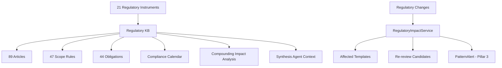

# Regulatory Radar (Pillar 5)

Living regulatory knowledge base with change tracking, impact analysis, and compliance calendar — covering 21 regulatory instruments (16 EU regulations/directives + 5 cross-cutting frameworks).

## Business Value

Regulatory landscape changes constantly. Regulatory Radar provides a structured knowledge base of applicable regulations, tracks changes with retroactive impact analysis, and surfaces upcoming deadlines via a compliance calendar.

## Architecture

## Regulatory Coverage

21 regulatory instruments seeded (`scripts/seed_regulatory_kb.py`):

- **16 EU instruments:** AMLR, AMLA, AMLD IV/V/VI, DSA, CRD, Omnibus, PSD2, SEPA/IPR, VAT/VIES, NIS2, DORA, MiFID II, eIDAS 2.0, BE-PEPPOL
- **5 cross-cutting frameworks:** GDPR, EU AI Act, ISO 27001, ISO 42001, ISO 27701

## Data Model

| Table | Records | Purpose |
|-------|---------|---------|
| `regulations` | 21 | Core regulation metadata |
| `regulatory_articles` | 89 | Individual articles with scope rules |
| `regulatory_obligations` | 44 | Specific compliance obligations |
| `scope_rules` | 47 | Vertical/country applicability rules |
| `regulatory_changes` | 0+ | Change tracking with impact assessment |

## Key Services

- **`app/services/regulatory_knowledge_service.py`** — `RegulatoryKnowledgeService` query methods: `get_regulations`, `get_regulation`, `get_articles`, `get_article_with_obligations`, `get_timeline`, `get_compliance_calendar`, `get_compounding_impact`, `get_stats`, `search_articles`, `get_coverage_report`
- **`app/services/regulatory_impact_service.py`** — `register_change`, `get_changes`, `analyze_impact`
- **`scripts/seed_regulatory_kb.py`** — Idempotent seeding of the 21 regulations, 89 articles, 47 scope rules, and 44 obligations (regulations upserted by `short_name`; articles/obligations/scope_rules cleared and re-inserted each run)

## Frontend

3-tab Regulatory Radar page at `/dashboard/regulatory`:
- **Timeline** — Chronological regulation overview
- **Calendar** — Upcoming deadlines with countdown
- **Coverage** — Per-regulation compliance coverage

## API Endpoints

| Method | Path | Description |
|--------|------|-------------|
| GET | `/api/regulatory/regulations` | List all regulations |
| GET | `/api/regulatory/regulations/{regulation_id}` | Get a single regulation |
| GET | `/api/regulatory/articles` | Search/filter articles |
| GET | `/api/regulatory/articles/{article_id}` | Get a single article with obligations |
| GET | `/api/regulatory/timeline` | Regulation timeline |
| GET | `/api/regulatory/calendar` | Compliance calendar |
| GET | `/api/regulatory/compounding-impact` | Compounding impact analysis |
| GET | `/api/regulatory/stats` | Knowledge base statistics |
| GET | `/api/regulatory/coverage/{workflow_id}` | Per-workflow regulatory coverage report |
| GET | `/api/regulatory/gaps/{workflow_id}` | Coverage gaps for a workflow |
| POST | `/api/regulatory/changes` | Register a change |
| GET | `/api/regulatory/changes` | List changes |
| GET | `/api/regulatory/impact/{change_id}` | Analyze change impact |

The router is mounted under `/api` (`app.include_router(regulatory.router, prefix="/api", …)`) and requires an authenticated user.

## Configuration

- `regulatory_radar_enabled` — Feature flag (default: `true`)
- Alembic migrations: `014_regulatory_knowledge_base` (schema), `050_seed_regulatory_radar` (seed); Lex linkage in `025_lex_regulatory_knowledge_layer`
