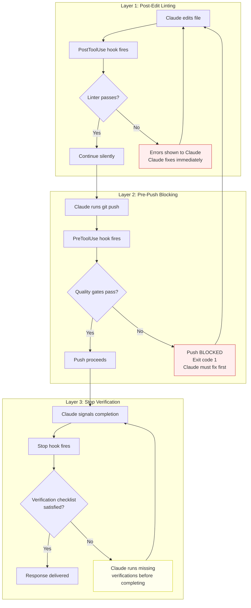
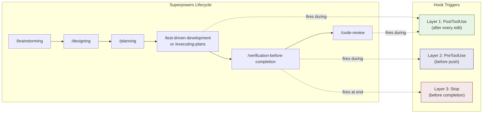

Quality gates are the structural enforcement layer of the S4U methodology. They transform quality standards from aspirational guidelines into automated, non-bypassable checks that run at precisely defined trigger points in the development flow. The developer does not choose whether to lint, whether tests must pass before push, or whether verification must precede completion claims — these decisions were made once, when the hooks were configured, and they apply to every subsequent change without requiring anyone to remember them.

This appendix specifies the full quality gate architecture: the 3-layer defense model, the Claude Code hook type system, implementation examples drawn from the Trust Relay compliance platform, integration with the Superpowers skills system, and guidance for creating custom hooks.

---

## Table of Contents

1. [3-Layer Defense Architecture](#1-3-layer-defense-architecture)
2. [Hook Type Reference](#2-hook-type-reference)
3. [Layer 1: Post-Edit Linting](#3-layer-1-post-edit-linting)
4. [Layer 2: Pre-Push Blocking](#4-layer-2-pre-push-blocking)
5. [Layer 3: Stop Verification](#5-layer-3-stop-verification)
6. [Hook Configuration Reference](#6-hook-configuration-reference)
7. [Integration with Superpowers](#7-integration-with-superpowers)
8. [Creating Custom Hooks](#8-creating-custom-hooks)
9. [Troubleshooting](#9-troubleshooting)

---

## 1. 3-Layer Defense Architecture

The quality gate system operates on a defense-in-depth principle. No single layer is sufficient on its own — each catches failures that slip past the others. The three layers are sequenced from fastest feedback (milliseconds after an edit) to broadest scope (verification of the entire deliverable before completion).



### Layer Characteristics

| Layer | Trigger | Scope | Failure Mode | Response Time |
|-------|---------|-------|-------------|---------------|
| **1 — Post-Edit** | After every Write/Edit tool call | Single file | Advisory (errors shown, not blocking) | < 1 second |
| **2 — Pre-Push** | Before git push executes | Entire codebase | Blocking (push fails with exit code 1) | 2-10 seconds |
| **3 — Stop** | When Claude is about to conclude | Entire deliverable | Re-prompting (Claude runs missing checks) | Variable |

### Why Three Layers

**Layer 1 alone is insufficient** because it catches only syntactic and style issues in the file just edited. It cannot detect cross-file breakage, test failures, or missing verification.

**Layer 2 alone is insufficient** because it only fires at push time. A developer who iterates for an hour before pushing discovers errors late. Layer 1 catches them within seconds.

**Layer 3 alone is insufficient** because it relies on Claude's judgment to determine whether verification was adequate. The prompt asks Claude to reflect, but without Layers 1 and 2, there would be nothing preventing Claude from rationalizing that "linting was not necessary for this change."

Together, the three layers create a system where quality is the path of least resistance. Fixing a lint error immediately (Layer 1) is faster than fixing it at push time (Layer 2), which is faster than fixing it when the Stop hook reveals it was missed (Layer 3).

---

## 2. Hook Type Reference

Claude Code provides three hook trigger points. Each serves a distinct purpose in the quality gate architecture.

### PreToolUse

**When it fires:** Before a tool call is executed. The hook receives the tool name and its input parameters as JSON on stdin.

**What it can do:** Block the tool call by exiting with a non-zero exit code. When blocked, Claude sees the hook's stderr output and must address the issue before retrying.

**Use cases:**
- Block destructive operations (`git push --force`, `git reset --hard`)
- Gate certain tools behind quality checks (e.g., require linting to pass before allowing push)
- Prevent writes to protected files (production configs, migration files without approval)

**Input format (stdin):**
```json
{
  "tool_name": "Bash",
  "tool_input": {
    "command": "git push origin master"
  }
}
```

**Exit behavior:**
- Exit 0 → tool call proceeds
- Exit non-zero → tool call is blocked; stderr message shown to Claude

### PostToolUse

**When it fires:** After a tool call has executed successfully. The hook receives the tool name, input, and output as JSON on stdin.

**What it can do:** Report issues to Claude. PostToolUse hooks are advisory — they cannot undo the tool call, but their output is shown to Claude, who can then take corrective action.

**Use cases:**
- Run linters on files after Write or Edit operations
- Validate generated code structure after file creation
- Check for common anti-patterns in committed code

**Input format (stdin):**
```json
{
  "tool_name": "Edit",
  "tool_input": {
    "file_path": "/path/to/file.py",
    "old_string": "...",
    "new_string": "..."
  }
}
```

**Exit behavior:**
- Exit 0 → output shown to Claude as informational
- Exit non-zero → output shown to Claude as a warning (tool call already completed)

### Stop

**When it fires:** When Claude is about to conclude its response — i.e., when the AI determines it has completed the user's request and is ready to stop generating.

**What it can do:** Present a prompt that Claude must address before completing. This is the most powerful hook because it catches premature completion claims: the moment when the AI declares "done" without having verified that the work actually meets quality standards.

**Configuration:** Stop hooks use inline prompts (not shell scripts). The prompt text is injected into Claude's context at the moment of completion, forcing Claude to evaluate whether verification criteria are met.

**Why this is the most powerful hook:**

AI models have a well-documented tendency to declare success confidently even when the implementation is incomplete or broken. The Stop hook intercepts this tendency at exactly the right moment — after the AI believes it is done but before the response reaches the user. The prompt forces the AI to self-audit against concrete verification criteria rather than its own confidence level.

---

## 3. Layer 1: Post-Edit Linting

Layer 1 provides immediate feedback after every file edit. The hook runs the relevant linter on the edited file and shows any errors to Claude, who can fix them before moving to the next change.

### settings.json Configuration

```json
{
  "hooks": {
    "PostToolUse": [
      {
        "matcher": "Edit|Write",
        "hooks": [
          {
            "type": "command",
            "command": ".claude/hooks/lint-edited.sh"
          }
        ]
      }
    ]
  }
}
```

The `matcher` field is a regex pattern matched against the tool name. `Edit|Write` fires the hook after either the Edit or Write tool is used. Without a `matcher`, the hook fires after every tool call.

### Hook Script: `lint-edited.sh`

```bash
#!/usr/bin/env bash
# PostToolUse hook: runs Ruff + Pyright on edited Python files
# Receives JSON on stdin with tool_use details

set -euo pipefail

# Read the tool input from stdin
INPUT=$(cat)

# Extract file path from the tool input
FILE_PATH=$(echo "$INPUT" | python3 -c "
import sys, json
try:
    data = json.load(sys.stdin)
    # Handle both Edit and Write tool inputs
    path = data.get('tool_input', {}).get('file_path', '')
    print(path)
except:
    print('')
" 2>/dev/null)

# Only lint Python files in the backend
if [[ "$FILE_PATH" == *.py ]] && [[ "$FILE_PATH" == *backend/app/* ]]; then
    cd "$(dirname "$0")/../../backend" 2>/dev/null || exit 0

    # Run ruff (fast, catches import errors and style issues)
    ruff check "$FILE_PATH" --quiet 2>/dev/null || true
fi
```

### Design Decisions

**Why `exit 0` on linter failure (|| true)?** Layer 1 is advisory, not blocking. The purpose is to show Claude the errors so it can fix them immediately. Blocking would prevent Claude from continuing to edit the file to fix the very errors the linter found.

**Why only `backend/app/*`?** Test files, configuration files, and scripts follow different style rules. Linting production code exclusively prevents false positives that erode trust in the hook system.

**Why Ruff and not Pyright here?** Ruff is fast (< 100ms per file). Pyright is slow (seconds to minutes for type analysis). Post-edit hooks must be imperceptible — any latency discourages Claude from making small, incremental edits. Pyright is reserved for Layer 2 (pre-push) and Layer 3 (stop verification) where the broader scope justifies the cost.

### Extending Layer 1 for Frontend

For projects with TypeScript, add a parallel hook script:

```bash
#!/usr/bin/env bash
# PostToolUse hook: runs ESLint on edited TypeScript files

set -euo pipefail

INPUT=$(cat)

FILE_PATH=$(echo "$INPUT" | python3 -c "
import sys, json
try:
    data = json.load(sys.stdin)
    path = data.get('tool_input', {}).get('file_path', '')
    print(path)
except:
    print('')
" 2>/dev/null)

# Only lint TypeScript files in the frontend
if [[ "$FILE_PATH" == *.ts ]] || [[ "$FILE_PATH" == *.tsx ]]; then
    if [[ "$FILE_PATH" == *frontend/src/* ]]; then
        cd "$(dirname "$0")/../../frontend" 2>/dev/null || exit 0
        npx eslint "$FILE_PATH" --quiet 2>/dev/null || true
    fi
fi
```

Register it alongside the Python hook:

```json
{
  "hooks": {
    "PostToolUse": [
      {
        "matcher": "Edit|Write",
        "hooks": [
          {
            "type": "command",
            "command": ".claude/hooks/lint-edited.sh"
          },
          {
            "type": "command",
            "command": ".claude/hooks/lint-edited-ts.sh"
          }
        ]
      }
    ]
  }
}
```

---

## 4. Layer 2: Pre-Push Blocking

Layer 2 is the hard gate. It prevents code from reaching the remote repository if quality standards are not met. Unlike Layer 1, this hook uses a non-zero exit code to block the operation entirely.

### settings.json Configuration

```json
{
  "hooks": {
    "PreToolUse": [
      {
        "matcher": "Bash",
        "hooks": [
          {
            "type": "command",
            "command": ".claude/hooks/pre-push-gate.sh"
          }
        ]
      }
    ]
  }
}
```

The hook fires on every Bash tool call. The script itself checks whether the command is a `git push` and only applies the gate in that case.

### Hook Script: `pre-push-gate.sh`

```bash
#!/usr/bin/env bash
# PreToolUse hook: blocks git push if quality gates fail
# Only triggers on git push commands

set -euo pipefail

INPUT=$(cat)

# Check if this is a git push command
COMMAND=$(echo "$INPUT" | python3 -c "
import sys, json
try:
    data = json.load(sys.stdin)
    cmd = data.get('tool_input', {}).get('command', '')
    print(cmd)
except:
    print('')
" 2>/dev/null)

if [[ "$COMMAND" == *"git push"* ]]; then
    cd "$(dirname "$0")/../../backend" 2>/dev/null || exit 0

    # Run ruff
    if ! ruff check app/ --quiet 2>/dev/null; then
        echo "BLOCKED: Ruff lint errors found. Fix before pushing." >&2
        exit 1
    fi
fi
```

### Extended Pre-Push Gate

The minimal version above checks only Ruff. A more thorough gate checks multiple quality dimensions:

```bash
#!/usr/bin/env bash
# PreToolUse hook: comprehensive pre-push quality gate

set -euo pipefail

INPUT=$(cat)

COMMAND=$(echo "$INPUT" | python3 -c "
import sys, json
try:
    data = json.load(sys.stdin)
    cmd = data.get('tool_input', {}).get('command', '')
    print(cmd)
except:
    print('')
" 2>/dev/null)

if [[ "$COMMAND" == *"git push"* ]]; then
    ERRORS=()
    PROJECT_ROOT="$(dirname "$0")/../.."

    # Gate 1: Ruff lint (backend)
    if [[ -d "$PROJECT_ROOT/backend" ]]; then
        cd "$PROJECT_ROOT/backend"
        if ! ruff check app/ --quiet 2>/dev/null; then
            ERRORS+=("Ruff lint errors in backend/app/")
        fi
    fi

    # Gate 2: Pyright type checking (backend)
    if [[ -d "$PROJECT_ROOT/backend" ]]; then
        cd "$PROJECT_ROOT/backend"
        if ! pyright app/ --outputjson 2>/dev/null | python3 -c "
import sys, json
data = json.load(sys.stdin)
errors = data.get('generalDiagnostics', [])
error_count = len([e for e in errors if e.get('severity') == 'error'])
sys.exit(1 if error_count > 0 else 0)
" 2>/dev/null; then
            ERRORS+=("Pyright type errors in backend/app/")
        fi
    fi

    # Gate 3: TypeScript compilation (frontend)
    if [[ -d "$PROJECT_ROOT/frontend" ]]; then
        cd "$PROJECT_ROOT/frontend"
        if ! npx tsc --noEmit 2>/dev/null; then
            ERRORS+=("TypeScript compilation errors in frontend/")
        fi
    fi

    # Report results
    if [[ ${#ERRORS[@]} -gt 0 ]]; then
        echo "BLOCKED: Pre-push quality gates failed:" >&2
        for err in "${ERRORS[@]}"; do
            echo "  - $err" >&2
        done
        echo "" >&2
        echo "Fix all errors before pushing." >&2
        exit 1
    fi
fi
```

### Design Decisions

**Why check only on `git push` and not `git commit`?** Commits are local working state. Blocking commits disrupts the natural rhythm of iterative development — Claude often commits partial progress to create save points. Pushes are the publication boundary; code that reaches the remote should meet quality standards.

**Why `exit 0` when the project root is not found?** The hook should fail open in ambiguous situations. If the directory structure is unexpected, the push should proceed rather than blocking with a confusing error. The principle: hooks should block on known quality failures, not on environmental uncertainty.

**Why stderr for error messages?** Claude Code displays stderr output from hooks directly to the AI. Messages on stderr are visible; messages on stdout may be captured but not displayed.

### Blocking Destructive Operations

A separate PreToolUse concern: preventing destructive git operations regardless of quality gates.

```bash
#!/usr/bin/env bash
# PreToolUse hook: block destructive git operations

set -euo pipefail

INPUT=$(cat)

COMMAND=$(echo "$INPUT" | python3 -c "
import sys, json
try:
    data = json.load(sys.stdin)
    cmd = data.get('tool_input', {}).get('command', '')
    print(cmd)
except:
    print('')
" 2>/dev/null)

# Block force pushes to protected branches
if [[ "$COMMAND" == *"git push"*"--force"* ]] || [[ "$COMMAND" == *"git push"*"-f "* ]]; then
    if [[ "$COMMAND" == *"main"* ]] || [[ "$COMMAND" == *"master"* ]]; then
        echo "BLOCKED: Force push to protected branch is forbidden." >&2
        exit 1
    fi
fi

# Block hard resets
if [[ "$COMMAND" == *"git reset --hard"* ]]; then
    echo "BLOCKED: git reset --hard can destroy work. Use git stash or git revert instead." >&2
    exit 1
fi

# Block clean -f without confirmation
if [[ "$COMMAND" == *"git clean -f"* ]]; then
    echo "BLOCKED: git clean -f permanently deletes untracked files. Review files first." >&2
    exit 1
fi
```

---

## 5. Layer 3: Stop Verification

Layer 3 is the completion guard. It fires when Claude is about to conclude its response and forces the AI to verify that all quality criteria are met before delivering the output to the user.

### settings.json Configuration

```json
{
  "hooks": {
    "Stop": [
      {
        "hooks": [
          {
            "type": "prompt",
            "prompt": "Before completing: Have you verified with actual command output that (1) all relevant tests pass, (2) ruff check has zero errors on changed files, (3) pyright has zero errors on changed files, and (4) TypeScript compiles with zero errors if frontend was changed? If any of these were NOT verified, run them now before completing."
          }
        ]
      }
    ]
  }
}
```

### How the Stop Hook Works

Unlike PreToolUse and PostToolUse hooks, which execute shell commands, the Stop hook injects a prompt into Claude's context at the moment of completion. This prompt is processed as if the user had asked the question — Claude must address each verification criterion before it can complete its response.

The workflow:

1. Claude finishes its implementation and prepares to deliver the response.
2. The Stop hook intercepts and injects the verification prompt.
3. Claude evaluates whether each criterion is met:
   - If all criteria are satisfied (with evidence in the conversation), Claude completes normally.
   - If any criterion is not satisfied, Claude runs the missing verification commands and includes their output before completing.
4. The verification loop continues until all criteria are met.

### Why This Is the Most Powerful Hook

The Stop hook addresses the specific failure mode of premature completion — the AI's tendency to declare "I've implemented X and it should work" without having verified that X actually works. This failure mode is dangerous because:

- The AI's confidence is not correlated with correctness. A plausible-sounding implementation claim can mask a syntax error, a broken import, or a logic bug.
- Without the hook, the burden of verification falls on the human, who may trust the AI's confident declaration and move on.
- The hook makes verification a structural requirement, not a behavioral expectation.

### Designing Effective Stop Prompts

The prompt must be specific enough to be actionable but not so specific that it misses categories of verification. Principles:

**Enumerate the checks explicitly.** A vague prompt like "Have you verified your work?" allows the AI to rationalize that visual inspection was sufficient. An explicit prompt — "(1) all relevant tests pass, (2) ruff check has zero errors" — leaves no room for rationalization.

**Require actual command output.** The phrase "verified with actual command output" is load-bearing. Without it, Claude may claim verification based on its own analysis of the code rather than running the tools. Actual command output is objective evidence; Claude's analysis is subjective.

**Include all relevant dimensions.** The Trust Relay Stop hook covers four dimensions: tests, Python linting, Python type checking, and TypeScript compilation. Each dimension catches a different class of error. Omitting any one creates a blind spot.

**Use conditional language for optional checks.** "TypeScript compiles with zero errors **if frontend was changed**" prevents Claude from running irrelevant checks on backend-only changes, which would waste time and train Claude to treat the hook as busywork.

### Alternative Stop Prompts

For different project profiles:

**Backend-only Python project:**
```json
{
  "type": "prompt",
  "prompt": "Before completing: Have you verified with actual command output that (1) all relevant tests pass, (2) ruff check has zero errors on changed files, and (3) pyright has zero errors on changed files? If any of these were NOT verified, run them now before completing."
}
```

**Frontend-only project:**
```json
{
  "type": "prompt",
  "prompt": "Before completing: Have you verified with actual command output that (1) all relevant tests pass (npm test), (2) TypeScript compiles with zero errors (npx tsc --noEmit), and (3) ESLint has zero errors on changed files? If any of these were NOT verified, run them now before completing."
}
```

**Full-stack with coverage enforcement:**
```json
{
  "type": "prompt",
  "prompt": "Before completing: Have you verified with actual command output that (1) all relevant tests pass, (2) test coverage meets the minimum threshold for the changed layer, (3) ruff check has zero errors on changed Python files, (4) pyright has zero errors on changed Python files, and (5) TypeScript compiles with zero errors if frontend was changed? If any of these were NOT verified, run them now before completing."
}
```

### Enhanced Stop Hook — Test Mapping

The Stop hook should verify not just "did you run tests" but "did you run the RIGHT tests":

1. Look up modified files in `architecture-index.json`
2. Find mapped test files from the `tests:` frontmatter field
3. Verify ALL mapped tests were run
4. Verify quality checks (ruff, pyright, tsc) on changed files

### Common Stop Hook Mistakes

**Using `echo` instead of `prompt`:**

A Stop hook with `"type": "command"` and `"command": "echo 'verify X, Y, Z'"` is nearly useless. The `echo` output appears in Claude's tool result but Claude is not structurally required to act on it. It becomes a reminder that can be ignored — especially by subagents who don't even see it.

Always use `"type": "prompt"` for Stop hooks. This injects the verification checklist directly into Claude's reasoning context, making it a structural requirement rather than a suggestion.

```json
// ❌ WRONG — echo is ignorable
{"type": "command", "command": "echo 'Did you run tests?'"}

// ✅ CORRECT — prompt forces Claude to address each criterion
{"type": "prompt", "prompt": "Before completing: verify (1) tests pass, (2) linting clean."}
```

**Combining command + prompt in Stop hooks:**

It IS valid to mix both types. Use `command` hooks to run validation scripts (like `check-docs-sync.sh`), and use a `prompt` hook to force Claude to verify the results. The command output flows into Claude's context alongside the prompt.

```json
"Stop": [{
  "hooks": [
    {"type": "command", "command": "bash scripts/check-docs-sync.sh 2>/dev/null || true"},
    {"type": "command", "command": "bash scripts/check-adr.sh 2>/dev/null || true"},
    {"type": "prompt", "prompt": "Before completing: verify with actual output..."}
  ]
}]
```

### Subagent Blind Spot

**Subagents dispatched via the Agent tool do not inherit any hooks from the parent session.** This is a fundamental limitation of the Claude Code architecture — each agent starts with a fresh context and no hook configuration.

This means:
- **Layer 1 (Post-Edit)**: Subagent edits are NOT linted automatically
- **Layer 2 (Pre-Push)**: Subagent pushes are NOT gated (though subagents rarely push)
- **Layer 3 (Stop)**: Subagent has NO verification prompt before completing

**Mitigation strategies:**

1. **Include quality gates in the subagent prompt.** When dispatching a subagent, explicitly include the quality requirements:
   ```
   Quality gates:
   - Run `ruff check --select F` on all changed Python files
   - Run `tsc --noEmit` if frontend files changed
   - Run relevant tests and verify they pass
   ```

2. **Include architecture documentation protocol.** If the subagent will modify backend files, include:
   ```
   Before modifying files, read docs/architecture-index.json and check
   if the file is mapped to a Docusaurus page. If so, read the page first.
   After implementation, update the Docusaurus page if needed.
   ```

3. **Run quality gates in the parent session after receiving subagent results.** The coordinator should verify the subagent's work meets all quality criteria before marking the task complete.

4. **Use the `superpowers:subagent-driven-development` skill** which includes a two-stage review process (spec compliance + code quality) after each subagent completes.

### Security Scanning Hooks

**Dev-time (Aikido plugin):**
The Aikido plugin runs SAST scanning after code changes, with an auto-remediation loop: scan → identify → fix → re-scan (up to 3 iterations).

**PR-time (GitHub Action):**
Add `anthropics/claude-code-security-review` to `.github/workflows/` for automated security review on every pull request.

---

## 6. Hook Configuration Reference

### Complete settings.json Structure

The following shows a full quality gate configuration combining all three layers:

```json
{
  "hooks": {
    "PreToolUse": [
      {
        "matcher": "Bash",
        "hooks": [
          {
            "type": "command",
            "command": ".claude/hooks/pre-push-gate.sh"
          }
        ]
      }
    ],
    "PostToolUse": [
      {
        "matcher": "Edit|Write",
        "hooks": [
          {
            "type": "command",
            "command": ".claude/hooks/lint-edited.sh"
          }
        ]
      }
    ],
    "Stop": [
      {
        "hooks": [
          {
            "type": "prompt",
            "prompt": "Before completing: Have you verified with actual command output that (1) all relevant tests pass, (2) ruff check has zero errors on changed files, (3) pyright has zero errors on changed files, and (4) TypeScript compiles with zero errors if frontend was changed? If any of these were NOT verified, run them now before completing."
          }
        ]
      }
    ]
  }
}
```

### Configuration Fields

| Field | Required | Type | Description |
|-------|----------|------|-------------|
| `hooks` | Yes | Object | Top-level container. Keys are trigger types: `PreToolUse`, `PostToolUse`, `Stop` |
| `[trigger]` | — | Array | Array of hook groups for this trigger type |
| `matcher` | No | String (regex) | Regex matched against the tool name. If omitted, the hook fires for all tools of that trigger type. Only applicable to `PreToolUse` and `PostToolUse`. |
| `hooks` | Yes | Array | Array of hook definitions within a hook group |
| `type` | Yes | `"command"` or `"prompt"` | `command` runs a shell script; `prompt` injects a text prompt. `prompt` is only used with `Stop` hooks. |
| `command` | Conditional | String | Path to the shell script (relative to project root). Required when `type` is `"command"`. |
| `prompt` | Conditional | String | Prompt text injected into Claude's context. Required when `type` is `"prompt"`. |

### Hook File Placement

```
project-root/
├── .claude/
│   ├── settings.json        # Hook configuration (references scripts below)
│   └── hooks/
│       ├── lint-edited.sh    # PostToolUse: lint Python files after edit
│       ├── lint-edited-ts.sh # PostToolUse: lint TypeScript files after edit
│       └── pre-push-gate.sh  # PreToolUse: block push on quality failures
```

Hook scripts must be executable (`chmod +x`). The path in `settings.json` is relative to the project root, not to the `.claude` directory.

### Multiple Hook Groups

Multiple hook groups for the same trigger type are processed in array order. Each group can have its own matcher and its own set of hooks:

```json
{
  "hooks": {
    "PreToolUse": [
      {
        "matcher": "Bash",
        "hooks": [
          { "type": "command", "command": ".claude/hooks/pre-push-gate.sh" }
        ]
      },
      {
        "matcher": "Write",
        "hooks": [
          { "type": "command", "command": ".claude/hooks/validate-write-target.sh" }
        ]
      }
    ]
  }
}
```

---

## 7. Integration with Superpowers

The quality gate system and the Superpowers skills plugin operate on complementary planes. Skills govern process (what steps to follow and in what order). Hooks enforce verification (whether the output of those steps meets quality standards). Together, they create defense in depth — the process layer makes it likely that quality will be achieved, and the hook layer guarantees that quality failures are caught if the process is imperfect.

### The Verification Overlap

The Superpowers `verification-before-completion` skill and the Stop hook both address premature completion. This is intentional redundancy, not duplication:

| Mechanism | Enforcement Level | Bypassable? | Scope |
|-----------|-------------------|-------------|-------|
| `verification-before-completion` skill | Process instruction in skill prompt | AI can rationalize skipping if context is lost | Broad: covers test output, code review, documentation |
| Stop hook in `settings.json` | Infrastructure (fires automatically) | Cannot be bypassed without editing settings.json | Focused: specific verification commands |

The skill tells Claude to verify. The hook ensures Claude verifies even if the skill's instructions have faded from active context in a long session. The skill covers qualitative checks (did you review the code? is the documentation updated?). The hook covers quantitative checks (do tests pass? does the linter report zero errors?).

### Lifecycle Integration Points

The quality gates interact with specific Superpowers lifecycle skills at defined points:



**During implementation** (`/test-driven-development` or `/executing-plans`): Layer 1 fires after every file edit, providing immediate lint feedback. This keeps the code clean as it is written, reducing the number of errors that accumulate.

**During verification** (`/verification-before-completion`): The skill instructs Claude to run tests and linting. If Claude then attempts to push, Layer 2 fires and blocks on any remaining errors. When Claude signals completion, Layer 3 fires and asks whether all verification criteria are met.

**During review** (`/code-review`): If the reviewer agent makes corrections, Layer 1 fires on each edit, ensuring that review fixes do not introduce new lint errors.

### When Skills and Hooks Disagree

If a skill says "verification is complete" but the Stop hook reveals that tests were not actually run, the hook takes precedence. The hook's output is concrete (actual command output showing test results or their absence), while the skill's assessment is the AI's interpretation. Concrete evidence overrides interpretive claims.

---

## 8. Creating Custom Hooks

### Step-by-Step Guide

**Step 1: Identify the trigger point.**

Determine when the hook should fire:
- Before a tool call executes → `PreToolUse`
- After a tool call executes → `PostToolUse`
- Before Claude completes its response → `Stop`

**Step 2: Determine the scope.**

Should the hook fire for all tool calls or only specific ones? If specific, define the `matcher` regex. Common matchers:

| Matcher | Fires on |
|---------|----------|
| `Bash` | All Bash tool calls |
| `Edit\|Write` | Edit or Write tool calls |
| `Read` | Read tool calls |
| (omitted) | All tool calls of that trigger type |

**Step 3: Choose the hook type.**

- `command` — for checks that require running an external program (linters, test runners, file validators)
- `prompt` — for checks that require Claude's judgment (only available for `Stop` hooks)

**Step 4: Write the hook.**

For command hooks, create a shell script in `.claude/hooks/`:

```bash
#!/usr/bin/env bash
set -euo pipefail

# Read JSON input from stdin
INPUT=$(cat)

# Extract relevant fields using Python (available in most environments)
FIELD=$(echo "$INPUT" | python3 -c "
import sys, json
try:
    data = json.load(sys.stdin)
    value = data.get('tool_input', {}).get('your_field', '')
    print(value)
except:
    print('')
" 2>/dev/null)

# Your validation logic here
if [[ "$FIELD" == "problematic_value" ]]; then
    echo "BLOCKED: Explanation of what went wrong." >&2
    exit 1
fi
```

For prompt hooks, write the prompt text directly in settings.json.

**Step 5: Register the hook in settings.json.**

Add the hook to the appropriate trigger array in `.claude/settings.json`:

```json
{
  "hooks": {
    "PreToolUse": [
      {
        "matcher": "YourToolMatcher",
        "hooks": [
          {
            "type": "command",
            "command": ".claude/hooks/your-hook.sh"
          }
        ]
      }
    ]
  }
}
```

**Step 6: Make the script executable.**

```bash
chmod +x .claude/hooks/your-hook.sh
```

**Step 7: Test the hook.**

Trigger the hook by performing the action it monitors. Verify:
- The hook fires at the correct time
- The hook produces the expected output
- Blocking hooks actually block (exit code 1)
- Non-blocking hooks display their output

### Best Practices

#### Fail-Open vs. Fail-Closed

**Fail-open** (exit 0 on uncertainty): Use for advisory hooks and situations where the hook's environment may be unexpected. Layer 1 (post-edit) hooks should fail open — if the linter is not installed, the edit should still proceed.

```bash
# Fail-open: if we can't find the project root, exit cleanly
cd "$(dirname "$0")/../../backend" 2>/dev/null || exit 0
```

**Fail-closed** (exit 1 on uncertainty): Use only for security-critical hooks where allowing the operation on failure would be worse than blocking it. Example: a hook that blocks pushes to production branches should fail-closed if it cannot determine the target branch.

```bash
# Fail-closed: if we can't determine the branch, block the push
BRANCH=$(git rev-parse --abbrev-ref HEAD 2>/dev/null)
if [[ -z "$BRANCH" ]]; then
    echo "BLOCKED: Cannot determine current branch." >&2
    exit 1
fi
```

#### Timeout Handling

Hook scripts should complete within a few seconds. Long-running hooks degrade the development experience and may cause Claude to treat them as noise. Guidelines:

| Hook Layer | Target Duration | Maximum Duration |
|------------|----------------|-----------------|
| Layer 1 (PostToolUse) | < 1 second | 5 seconds |
| Layer 2 (PreToolUse) | < 5 seconds | 30 seconds |

If a check takes longer than these thresholds, consider:
- Running it only on the changed files, not the entire codebase
- Moving it from Layer 1 to Layer 2 (less frequent trigger)
- Running it as a background check rather than a blocking hook

#### Error Messages

Error messages should be actionable. The message is shown to Claude, who must understand what failed and how to fix it.

**Poor error message:**
```
BLOCKED: Quality check failed.
```

**Good error message:**
```
BLOCKED: Ruff lint errors found in backend/app/services/risk_engine.py.
Fix lint errors before pushing. Run: ruff check backend/app/ --quiet
```

The good message identifies the failing file, the nature of the failure, and the command to run for details.

#### Idempotency

Hooks should be idempotent — running them multiple times on the same input should produce the same result. Avoid hooks that modify state (e.g., auto-fixing lint errors in a PreToolUse hook could create surprising behavior).

### Example: Custom Hook for Migration Safety

A hook that prevents pushing if new Alembic migrations reference tables that do not exist in the ORM models:

```bash
#!/usr/bin/env bash
# PreToolUse hook: validate Alembic migrations reference existing ORM models
# Prevents pushing migrations that create orphaned tables

set -euo pipefail

INPUT=$(cat)

COMMAND=$(echo "$INPUT" | python3 -c "
import sys, json
try:
    data = json.load(sys.stdin)
    cmd = data.get('tool_input', {}).get('command', '')
    print(cmd)
except:
    print('')
" 2>/dev/null)

if [[ "$COMMAND" == *"git push"* ]]; then
    PROJECT_ROOT="$(dirname "$0")/../.."

    # Find tables referenced in staged migration files
    STAGED_MIGRATIONS=$(git diff --cached --name-only -- 'backend/alembic/versions/*.py' 2>/dev/null)

    if [[ -n "$STAGED_MIGRATIONS" ]]; then
        # Extract table names from op.create_table calls in staged migrations
        MIGRATION_TABLES=$(echo "$STAGED_MIGRATIONS" | xargs grep -h "op.create_table" 2>/dev/null \
            | sed "s/.*op.create_table(['\"]//;s/['\"].*//" | sort -u)

        # Extract table names from ORM models
        ORM_TABLES=$(grep "__tablename__" "$PROJECT_ROOT/backend/app/db/models.py" 2>/dev/null \
            | sed "s/.*= ['\"]//;s/['\"].*//" | sort -u)

        # Check for orphaned tables
        ORPHANS=$(comm -23 <(echo "$MIGRATION_TABLES") <(echo "$ORM_TABLES") 2>/dev/null)

        if [[ -n "$ORPHANS" ]]; then
            echo "BLOCKED: Migration creates tables not defined in ORM models:" >&2
            echo "$ORPHANS" | while read -r table; do
                echo "  - $table" >&2
            done
            echo "" >&2
            echo "Add ORM model definitions to backend/app/db/models.py first." >&2
            exit 1
        fi
    fi
fi
```

---

## 9. Troubleshooting

### Hook Does Not Fire

**Check the trigger type.** `PreToolUse` fires before the tool; `PostToolUse` fires after. If you expect a hook to prevent an action, it must be `PreToolUse`.

**Check the matcher.** The matcher is a regex matched against the tool name. Tool names are case-sensitive: `Bash`, `Edit`, `Write`, `Read`. Verify with a permissive matcher first (omit `matcher` entirely), then narrow.

**Check the file path.** The `command` path is relative to the project root. If the project root is `/home/user/myproject`, a command of `.claude/hooks/myhook.sh` resolves to `/home/user/myproject/.claude/hooks/myhook.sh`.

**Check permissions.** The script must be executable: `chmod +x .claude/hooks/myhook.sh`.

### Hook Fires But Does Not Block

**Check the exit code.** Only `PreToolUse` hooks can block. They block by exiting with a non-zero code. `PostToolUse` hooks cannot block — the tool has already executed.

**Check stderr vs stdout.** Error messages must be written to stderr (`echo "..." >&2`) to be displayed to Claude.

### Hook Is Too Slow

**Profile the script.** Add timing:
```bash
START=$(date +%s%N)
# ... your logic ...
END=$(date +%s%N)
echo "Hook took $((($END - $START) / 1000000))ms" >&2
```

**Reduce scope.** Lint only the changed file, not the entire codebase. Use `--quiet` flags to suppress verbose output.

**Move to a less frequent trigger.** If a check is slow but valuable, move it from Layer 1 (every edit) to Layer 2 (push only).

### Stop Hook Does Not Trigger Re-Verification

**Check the prompt wording.** The prompt must be specific and directive. Vague prompts ("Are you sure you're done?") allow Claude to answer "yes" without running commands. Specific prompts ("Have you verified with actual command output that...") require concrete evidence.

**Check for conflicting instructions.** If the project CLAUDE.md or a skill prompt tells Claude to skip verification under certain conditions, this may override the Stop hook's intent. The Stop hook prompt should be authoritative — use language like "If any of these were NOT verified, run them now before completing."

---

## Summary

The 3-layer quality gate system transforms quality standards from documentation into infrastructure. Each layer addresses a different failure mode at a different point in the development flow:

| Layer | Catches | Example |
|-------|---------|---------|
| **1 — Post-Edit** | Syntax errors, import mistakes, style violations — immediately | Missing import after adding a new dependency |
| **2 — Pre-Push** | Cross-file breakage, test failures, type errors — before publication | Function signature change that breaks callers in other files |
| **3 — Stop** | Premature completion, missing verification, untested changes — before delivery | "I've implemented the feature" without running tests |

The hooks work alongside Superpowers skills to create defense in depth. Skills govern the process. Hooks enforce the outcome. Neither alone is sufficient; together, they make quality the path of least resistance.

---

*This appendix is part of the [S4U Development Methodology](overview). For the testing standard enforced by these quality gates, see [Appendix A](appendix-a-testing). For evidence of this system's effectiveness in production, see [Appendix F](appendix-f-evidence).*
