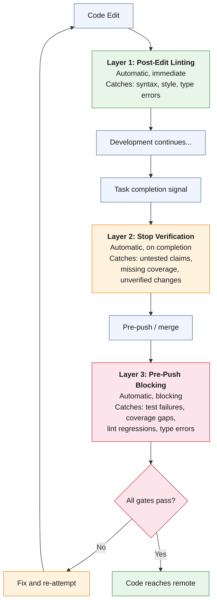

**Layer 1: Post-Edit Linting.** Runs automatically after file edits. The linter checks for syntax errors, style violations, and type errors. Feedback is immediate — the developer sees the issue within seconds of introducing it, while the code is still fresh in context. This layer catches the cheapest-to-fix category of defects: typos, missing imports, incorrect type annotations, unused variables.

**Layer 2: Stop Verification.** Runs automatically when the AI signals task completion. A verification prompt asks whether tests were run, coverage was checked, and linting passed. This layer catches the "it should work now" failure mode — the AI's tendency to declare completion based on confidence rather than evidence. The prompt fires every time, regardless of whether the developer remembered to invoke the `/verification-before-completion` skill. It is the safety net beneath the process layer.

**Layer 3: Pre-Push Blocking.** Runs before code reaches the remote repository. This is a hard gate — if tests fail, coverage is below threshold, or linting has regressions, the push is blocked. This layer is the last line of defense before code enters the shared codebase. It catches issues that passed through the first two layers — integration test failures that were not caught by unit tests, coverage drops from untested edge cases, lint regressions introduced by merge conflicts.

**Defense-in-depth rationale:** Each layer catches a different category of defect at a different cost level. A defect that escapes Layer 1 (post-edit) may still be caught by Layer 2 (stop verification) or Layer 3 (pre-push). The layers are redundant by design — no single gate failure allows a defect to reach the remote unchecked.

**Layer 4: Security Scanning.** For regulated systems, security scanning is a compliance requirement, not an optional quality improvement.

- **Dev-time:** Aikido plugin provides SAST scanning, secrets detection, and IaC misconfiguration detection with an auto-remediation loop (scan → fix → re-scan, up to 3 times).
- **PR-time:** The `anthropics/claude-code-security-review` GitHub Action runs semantic security analysis on every pull request, posting inline comments with severity and fix recommendations.

The four-layer defense: post-edit linting → security scanning → pre-push blocking → Stop verification.

**Evidence:** Trust Relay uses all three layers. The post-edit layer (Pyright LSP plugin) catches type errors in real-time. The Stop hook (verification prompt in `.claude/settings.json`) fires on every task completion. The pre-push layer is enforced through the `/verification-before-completion` skill's requirement for fresh test output. The combined effect is that defects are caught at the cheapest possible stage — type errors are fixed immediately (seconds), untested claims are caught before task sign-off (minutes), and integration failures are caught before push (minutes, not hours). See [appendix-f-evidence.md](../appendix-f-evidence) for the quality gate configuration and [appendix-e-hooks.md](../appendix-e-hooks) for the full hook specification.

---
