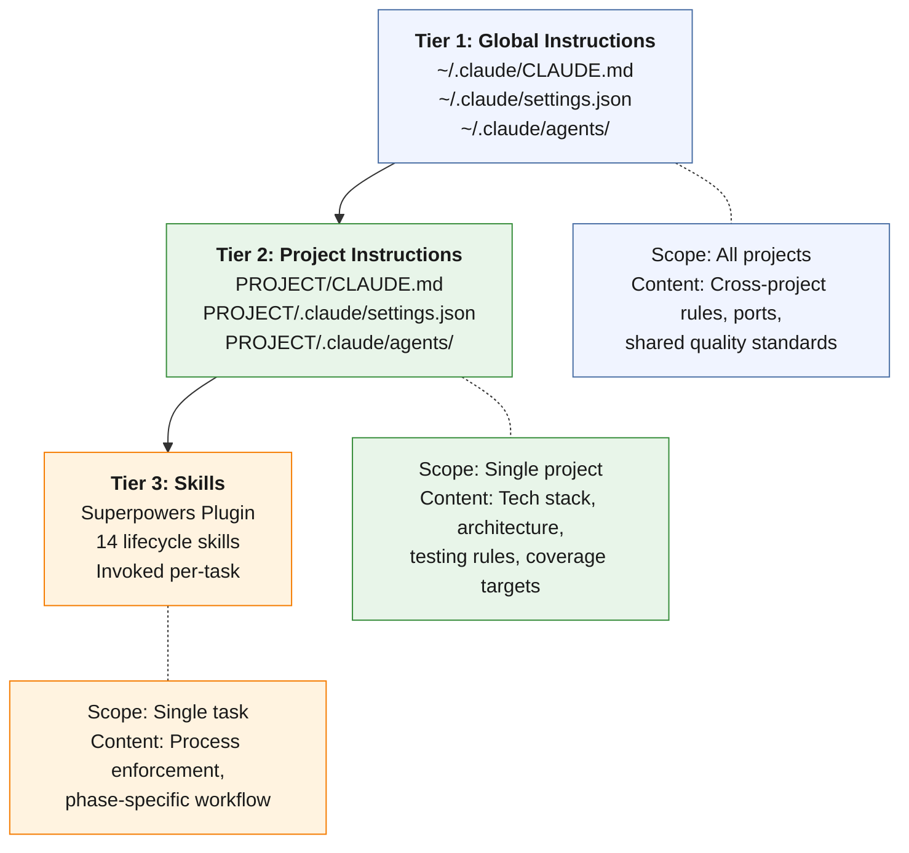

**How the tiers interact:**

Claude Code reads all three tiers at session start, but they serve fundamentally different purposes. Tier 1 (global) provides rules that apply regardless of which project is open — port assignments that prevent collisions between projects, quality standards that should be uniform across all work, and behavioral preferences that reflect the developer's working style. Tier 2 (project) provides the technical context that makes the AI useful for a specific codebase — the tech stack, the architecture, the testing conventions, the data flow. Tier 3 (skills) provides process enforcement at the task level — the brainstorm → design → plan → implement → verify → review lifecycle.

Instructions do not conflict across tiers because they address different concerns. Tier 1 says "always use Alembic for database migrations" (a cross-project rule). Tier 2 says "this project uses 31 Alembic migrations with RLS on 33 tables" (project-specific context). Tier 3 says "before marking this migration task complete, verify the migration applies and rolls back cleanly" (task-level process). Each tier adds precision without contradicting the others.

---
