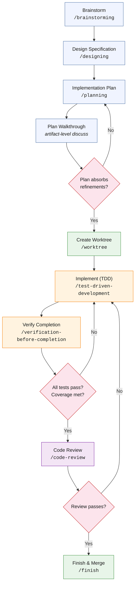

The full development cycle applies to any non-trivial new feature or architectural change. Trivial changes (configuration updates, typo fixes, single-line adjustments with no architectural impact) may skip directly to implementation.

**Phase details:**

**Brainstorm (`/brainstorming`).** Open-ended problem exploration. The skill guides the conversation through problem statement articulation, constraint identification, and generation of at least 3 candidate approaches with explicit tradeoffs. The output is a conversation log, not a document. Its purpose is to prevent the common failure mode of committing to the first approach that seems reasonable.

Duration: 10-30 minutes. Skip threshold: if the implementation approach is obvious and has no meaningful alternatives (e.g., "add a new column to an existing table with an obvious type and no migration concerns"), skip to design or planning.

**Design Specification (`/designing`).** Converts the brainstorm into a formal specification document. The skill uses the project's design document template, which includes: audience, problem statement, design decisions table (decision / choice / rationale), data flow, API contracts, error handling strategy, and testing strategy. The specification is committed to `docs/` (typically `docs/specs/` or `docs/plans/`) before any implementation begins.

Duration: 30-60 minutes. The output is the most important artifact in the lifecycle because it captures the *reasoning* behind the approach, not just the approach itself.

**Implementation Plan (`/planning`).** Decomposes the design specification into an ordered list of tasks. Each task specifies:

- Task number and title
- Dependencies (which tasks must complete first)
- Acceptance criteria (how to verify the task is done)
- Estimated complexity (used for session planning, not for time tracking)
- Files likely to be created or modified

Tasks are sized so that each can be completed in a single subagent session. A task that requires more than ~60 minutes of implementation is too large and should be split.

Tasks should be annotated with the parallelism marker `‖ parallelisable` when they can run concurrently with other tasks in the same dependency cohort. The marker is used by the wave-dispatch model in subagent-driven development (Section 5.4) to issue independent tasks to parallel subagents while preserving sequential ordering across cohorts.

**Plan Walkthrough.** Before any worktree is created and before any subagent is dispatched, the plan goes through a structured walkthrough with the human collaborator. The orchestrating session reads the plan task-by-task aloud (figuratively), and at each task asks: *Is the scope right? Are the file paths right? Is anything missing? Is anything redundant? Is the sequencing correct? Is the parallelism annotation honest?*

Duration: 15-45 minutes depending on plan size. Output: a revised plan that absorbs every refinement surfaced during the walkthrough, plus a brief revision-history note in the plan document explaining what changed and why.

This phase exists because plans drafted in isolation by an AI tend to carry subtle scope drift — tasks that solve the wrong problem at the right level of abstraction, dependencies that look sequential but are actually parallel, file paths that drift from the project's actual layout, and acceptance criteria that read well but cannot be verified mechanically. The walkthrough catches these in 15 minutes; the same defects discovered after dispatch cost hours of subagent work and review iterations.

The walkthrough is not "approve the plan." It is "improve the plan." A plan that emerges from the walkthrough unchanged is an unusual outcome, not a sign of high-quality drafting — it usually means the walkthrough was treated as a rubber stamp. The Ratiba M3 tenant-registry plan absorbed seven refinements + one architectural pre-commitment during its walkthrough, all of which would have surfaced as costly mid-execution rework if dispatched without it.

The output is a versioned plan document. The plan's status line should record the walkthrough completion (e.g., `Status: Revised 2026-04-25 to absorb walkthrough refinements`).

**Create Worktree (`/worktree`).** Creates a git worktree for the feature branch. Worktrees provide filesystem isolation: the feature branch exists in a separate directory, preventing accidental commits to the wrong branch. The skill handles branch creation, worktree setup, and context transfer (copying relevant memory files to the worktree's context).

**Implement with TDD (`/test-driven-development`).** The implementation phase uses test-driven development as the default execution model. The skill enforces the red-green-refactor cycle:

1. Write a failing test that describes the desired behavior.
2. Write the minimal implementation that makes the test pass.
3. Refactor the implementation while keeping tests green.

The skill includes an **anti-rationalization table** — a structured check that prevents the developer or AI from rationalizing why a test failure is "expected" or "not a real problem." Every test failure must either be fixed or explicitly documented as a known limitation.

In PoC mode, the cycle is relaxed: code-first, tests-after is acceptable. The tests are still mandatory; only the ordering is flexible.

**Verify Completion (`/verification-before-completion`).** Before marking any task complete, this skill requires evidence:

- Fresh test output with timestamps
- Coverage report showing threshold compliance
- Linter output with zero new warnings
- For UI changes: visual verification

This is the skill that implements the "evidence over claims" principle (Section 2.3) at the task level.

**Code Review (`/code-review`).** Two-stage review process (detailed in Section 3.3). First stage: spec compliance (does the implementation match the design?). Second stage: code quality (are patterns correct, tests sufficient, edge cases handled?).

**Finish & Merge (`/finish`).** Merges the feature branch, cleans up the worktree, and updates any memory files that should reflect the new state of the system. The skill ensures that documentation was updated alongside code (documentation commit pattern) and that the merge is clean.

---
